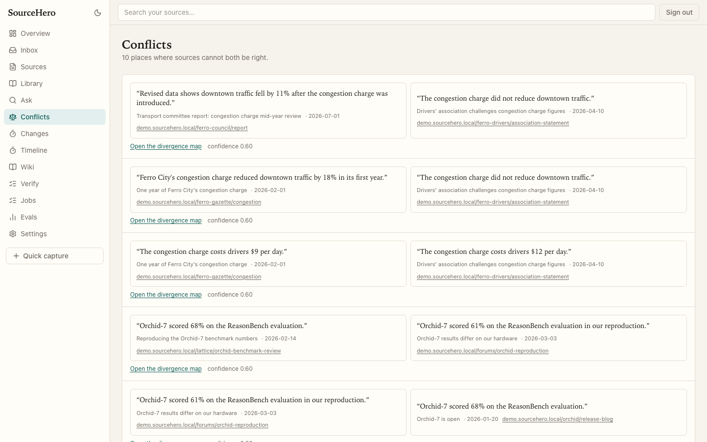
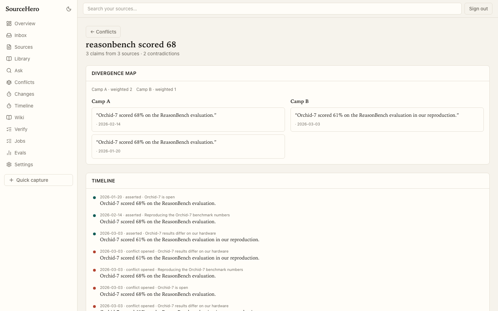
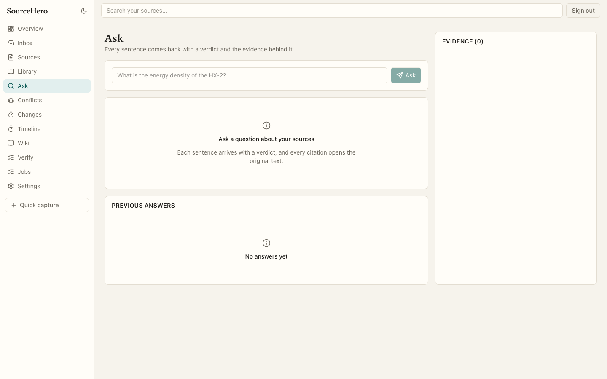
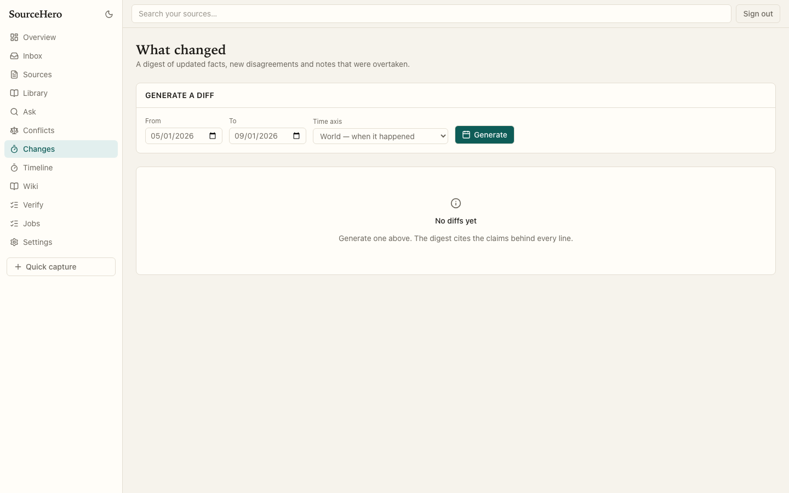
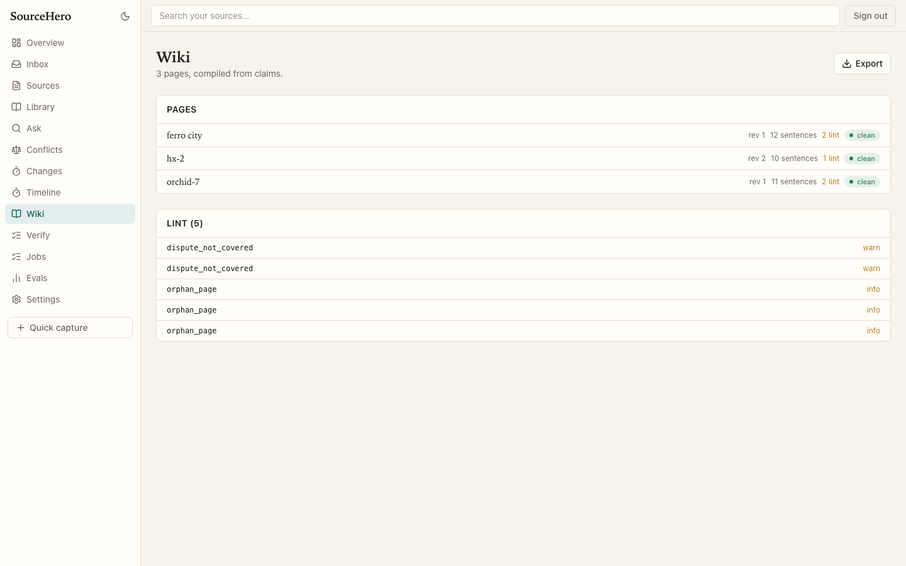

# SourceHero

**Your sources disagree. Now you will know where — and what changed.**

SourceHero turns a pile of articles, feeds and notes into a claim-level research
system. It keeps a ledger of what each source *asserts*, shows you exactly where two
of them cannot both be right, and tracks how those disagreements moved over time.

It runs entirely on your machine. It works with no model configured.



---

## What it does

### A claim ledger, not a summary

Every sentence a source makes becomes an atomic claim carrying a verbatim quote and the
character offsets of that quote inside the stored document. That invariant is checked,
not assumed: a claim whose quote cannot be located in the source is discarded rather
than stored. Any statement in the interface can be traced to the exact text that
produced it.

### Where sources disagree

Claims that cannot both be true are grouped into opposing camps, so you get an answer
to "who says what" rather than a blended paragraph.



A component that genuinely cannot be split in two — three sources each contradicting
the other two — is reported as *unbalanced* with its frustrated edges, rather than
forced into a false binary.

### Claims checked as you read

Ask a question and each sentence arrives with a verdict: **supported**,
**contradicted**, **disputed**, or **unsupported**, along with the evidence that
decided it. `disputed` is the interesting one — it means *this* sentence has evidence
on both sides.



### What changed, and when

A belief diff over any period, on either the world-time axis (when it happened) or the
observed-time axis (when you learned it — which is the honest framing when a Wayback
backfill run today inserts a snapshot from March).



### A wiki that rebuilds itself

Pages compile from claims rather than being written. Change a source and only the pages
that cited it recompile; every sentence keeps a footnote pointing back.



---

## How it differs from notebook-style research tools

| | NotebookLM, Open Notebook, Khoj | SourceHero |
|---|---|---|
| Unit of retrieval | chunk of text | **atomic claim** with a verbatim quote |
| When sources disagree | summarised into one answer | **surfaced as two camps**, never blended |
| Time | not modelled | bi-temporal: world time and observed time |
| Provenance | a link to the page | exact character offsets into the stored text |
| Verification | none built in | four verdicts per sentence, with the deciding evidence |
| Memory | answers you write | every claim's lifecycle: carried, superseded, retracted |
| Compilation | manual | pages rebuild when their inputs change |

Notebook-style tools answer *what the documents say*. SourceHero answers *what each
document claims, where they conflict, and what has changed*.

---

## Sixty seconds

```bash
make setup          # Python 3.12, dependencies, dashboard packages
make db-up          # Postgres 16 + pgvector on a free port
make migrate        # schema
make demo           # load the demo corpus and run the pipeline
make dev            # api + worker + dashboard
```

Open <http://127.0.0.1:3787>, create the first account (it owns the instance), and go
to **Inbox → Load demo corpus**. Then visit **Conflicts**.

---

## Running it

### Local

```bash
make setup && make db-up && make migrate && make demo && make dev
```

Ports come from `.env`, and `scripts/ports.sh` finds free ones because other projects
on the same machine may already hold them. `make stop` stops only what `make dev`
started.

### Containers

```bash
# Set a real secret first; the app refuses to boot in production with the default.
python -c "import secrets; print(secrets.token_urlsafe(48))"   # → SOURCEHERO_SECRET_KEY
docker compose --profile app up -d
```

Four services: `db`, `api` (runs migrations, then uvicorn), `worker` and `web`.

### Checks

```bash
make check       # backend lint + tests, then dashboard lint + typecheck + build
make e2e         # Playwright against a full stack on its own database
make eval        # evaluation report → evals/reports/latest.md
```

---

## Connecting a model

Nothing below is required. With no model configured the app runs on heuristics, and
every result says so in its `method` field rather than pretending otherwise.

**Settings → Model** accepts an API key, a token command, or a generic OAuth2
authorization-code + PKCE flow. The presets are `fake` (offline), `opencode-go` and
`openai`.

Two things worth knowing:

- `EMBEDDING_PROVIDER=fastembed` swaps the hashing embedder for a real one. It needs a
  ~100–500 MB model download, and the similarity thresholds must be recalibrated
  afterwards — the two spaces are not comparable.
- If a step raises an `LLMError`, it falls back to its heuristic and the result is
  labelled `heuristic(fallback:<code>)`. It degrades; it does not fail.

---

## MCP for agents

Nine tools over Streamable HTTP (`/mcp`) and stdio, each returning its evidence:

```bash
claude mcp add --transport http sourcehero http://127.0.0.1:8787/mcp \
  --header "Authorization: Bearer $PAT"
```

Full reference: [docs/AGENTS_API.md](docs/AGENTS_API.md).

---

## Numbers

Offline, `hashing` embedder, `fake` LLM. Full method and caveats in
[evals/README.md](evals/README.md).

> **Withdrawn pending v2.1 (code review, 2026-10-04).** The macro-F1 figures below
> were computed with a per-class true-positive bug (a fully swapped prediction scores
> 1.0), the claims suite fed gold-label-derived similarities into the judge, and the
> extraction gold spans were hand-typed and cut mid-word. Treat the verify, claims and
> extraction rows as invalid until they are recomputed. Retrieval recall@5 and MRR are
> unaffected; nDCG is being rechecked for double-counted documents. Details:
> [docs/dev/REVIEW_2026-10-04.md](docs/dev/REVIEW_2026-10-04.md) (EVAL-1 to EVAL-7).

| suite | metric | value |
|---|---|---|
| retrieval | recall@5 | 1.000 |
| retrieval | MRR / nDCG@10 | 0.852 / 0.913 |
| verify | macro-F1 | ~~0.753~~ withdrawn |
| extraction | alignment rate / precision | ~~1.000 / 0.970~~ withdrawn |
| claims | macro-F1 | ~~0.548~~ withdrawn |

Two of these deserve their caveats read rather than skipped. Retrieval's 1.000 is a
**16-chunk corpus** — it proves the path has not regressed, and says nothing about
ranking at scale. Claims at 0.548 is the weak spot, and it is a real finding: the
offline heuristic over-calls *supports* on same-topic pairs whose difference is
semantic ("revenue rose 12%" versus "headcount rose 12%"). The LLM relation judge that
is meant to handle those is not wired in yet; it lands in v2.1.

---

## Design decisions

**Postgres does the queue, the vectors and full-text search.** One database means the
transactional guarantees you need where the consistency actually lives — claims,
versions and their offsets must agree. It also means the thing you can back up is the
thing you can query.

**Reconciliation recomputes rather than appends.** A Wayback backfill routinely inserts
a version that is *chronologically earlier* than what you already have. An incremental
pass cannot answer "what if this snapshot had arrived first?", so a document's whole
claim lifecycle is recomputed from its full version set. Same versions in, same
lifecycle out, whatever order the jobs ran in.

**Quoting is re-read from the source, never trusted.** A model asked to quote will
paraphrase, normalise a character, or invent a span. Alignment locates the quote in the
stored text — exactly, then normalised, then fuzzily — and anything that cannot be
located is thrown away.

**A false claim is worse than a missing one.** Extraction is deliberately conservative.
A claim that is absent is invisible; a claim that is wrong gets compared against other
sources and manufactures a disagreement nobody can explain.

**Contradiction needs comparable quantities.** "450 Wh/kg" and "$120/kWh" are
*unrelated*, not in agreement. Treating a missing unit as agreement would make every
unrelated pair support every other.

**Judging is bounded.** Each new claim compares against at most five candidates found
by embedding search, so the cost of ingesting is independent of how much you have
already ingested.

---

## Limitations

**Known issues in v2.0.0-rc1.** A code review on 2026-10-04 found problems that matter
beyond the demo corpus:
- a cross-tenant read in the document diff endpoint
- no SSRF guard on fetching
- every upload sharing one identity, so the second upload overwrites the first
- failed jobs retrying forever
- reconciliation undoing cross-document supersession
- the LLM-enhanced paths (extraction, relation judging, streamed answers) not yet wired in
- UI uploads failing

They are listed with fixes in [docs/dev/REVIEW_2026-10-04.md](docs/dev/REVIEW_2026-10-04.md)
and scheduled in [docs/dev/ITERATION_PLAN_v2.1.md](docs/dev/ITERATION_PLAN_v2.1.md).
Do not run this build anywhere other than your own machine until v2.1.

- **The offline relation judge is weak on semantic differences** — two claims that
  differ only in *what* is being measured. This is the largest gap, and it is measured
  rather than hidden.
- **The default embedder is a hashing vectorizer.** It has no notion of synonymy: two
  sentences with entirely different words score near zero even when they agree. Switch
  to `fastembed` and recalibrate before relying on clustering quality.
- **Retrieval returns a whole chunk.** Claim extraction narrows it, but search on its
  own gives you a paragraph, not a sentence.
- **Extraction recall is unmeasured for now.** The filter is conservative by choice (see
  above), but the gold spans the old "about half" figure came from were corrupt; it is
  being remeasured in v2.1.
- **One document format wins.** PDFs become one document with a page map; a
  multi-column layout may read in an odd order.
- **Authentication is email and password only.** The first account owns the instance.
  Do not expose it to a network you do not control without putting something in front
  of it.

---

## Documentation

- [docs/ARCHITECTURE.md](docs/ARCHITECTURE.md) — data model, pipeline, algorithms, trade-offs
- [docs/AGENTS_API.md](docs/AGENTS_API.md) — REST and MCP for agents
- [evals/README.md](evals/README.md) — what is measured, and what the numbers do not say
- [AGENTS.md](AGENTS.md) — working rules for agents on this repository
- [docs/dev/](docs/dev/) — the build plan, progress, and decision log

---

## About me

Built by **Jeremy Liu** · UC Berkeley '27 · [GitHub @JeremyL691](https://github.com/JeremyL691)

If you are looking at this for a role, the parts I would point to first: end-to-end
ownership of a multi-tenant backend (FastAPI + Postgres + pgvector), a working RAG
pipeline with hybrid retrieval and click-through citations, and a Next.js frontend
that talks to it through JWT-scoped APIs.

v2 adds the parts that were missing from v1: a claim-level ledger with verbatim quote
offsets, a signed-graph disagreement detector, bi-temporal reconciliation, and an
evaluation harness that reports what the heuristics actually get wrong.

---

## License

[MIT](LICENSE)
