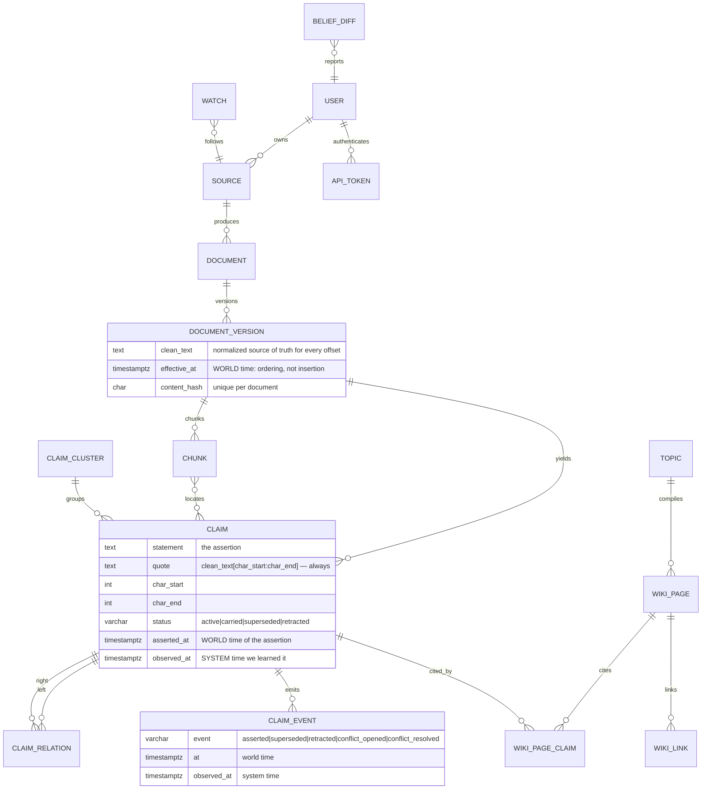

# Architecture

How SourceHero is put together, why, and where it is known to be weak.

---

## The shape of the system

```
capture ─► ingest_source ─► index_version ─► extract_claims ─┬─► cluster_claims ─► judge_relations ─┐
                                                          │                                       │
                                                          └────────► reconcile_document ──────────┤
                                                                                                  ▼
   search ◄── hybrid retrieval ◄── chunks ◄── PostgreSQL (tsvector + pgvector)              plan_topics
                                                                                                  │
   ask / verify ◄── evidence ◄── claims ◄── claim_relations ◄── claim_clusters ◄───────── compile_wiki_page
                                                                                                  │
                                                                   belief_diff ◄── claim_events ◄─┘
```

Four data flows, all in one database:

| flow | direction | purpose |
|---|---|---|
| **ingestion** | source → document → version → chunk | get text into the database, once, with offsets |
| **claims** | chunk → claim → cluster → relation | turn sentences into a checkable ledger |
| **time** | version pairs → claim status + events | track what was superseded, and when |
| **compilation** | claim clusters → topic → wiki page | build prose that rebuilds when inputs change |

---

## Data model



### The invariant everything rests on

```
version.clean_text[claim.char_start : claim.char_end] == claim.quote
```

Every citation in the interface, every footnote in the wiki and every highlight in the
reader resolves through this. It holds because the quote is **re-read from the stored
text** after alignment, never taken from whatever produced it. A claim whose quote
cannot be located is dropped, not stored.

`tests/test_claims.py::test_every_claim_quote_reproduces_the_source` asserts it across
the whole demo corpus.

---

## Retrieval

Two legs, fused by reciprocal rank fusion.

**Lexical** — `tsvector` over tokenized text. `search_text` is written with jieba for
CJK and a regex for Latin, and Postgres maintains `tsv` as a generated column.

**Vector** — pgvector HNSW over 384-dimensional embeddings.

```
RRF(d) = Σ over lists containing d of  1 / (k + rank_in_that_list)
```

Rank fusion rather than score blending is the key choice: `ts_rank_cd` is unbounded and
cosine distance is a distance. Blending them would require inventing a normalisation
constant; RRF only reads orderings, so both legs contribute on their own scale.

Query parameters are bound through SQLAlchemy's `cosine_distance` operator, not raw
SQL — psycopg3 sends a Python list as `numeric[]`, which makes `<=>` fail to resolve.

**Filters** default to each document's *current* version. A superseded sentence is not
retrievable as present-tense fact unless you ask for history explicitly
(`include_old_versions`).

**Embeddings.** The default `HashingEmbedder` is a signed hashing vectorizer over token
unigrams and bigrams: `blake2b` for the bucket, the high bit for the sign, L2
normalised. It is deterministic, needs no download, and produces identical vectors on
every machine — which is what makes the test suite, the e2e run and the demo
reproducible. It has no notion of synonymy, so unrelated-but-equal sentences score near
zero. `fastembed` is the production choice; switching requires recalibrating
`CLUSTER_SIM` / `PAIR_SIM` / `DUP_SIM` / `TOPIC_SIM`, which are measured per embedder in
`app/claims/cluster.py`.

---

## Claims

### Extraction

Sentences become claims if they have something to be wrong about: a quantity, a date, or
an explicit assertion. Length thresholds differ by script because the units do — three
content tokens is a real English claim ("Orchid-7 has 7 billion parameters.") and
noise in Chinese.

English verbs match by **stem prefix**, not by enumerating inflections, and the search
runs over raw words rather than `content_tokens`: `will`, `is` and `are` are stopwords,
and they are exactly the words that decide whether a sentence is a prediction or an
assertion.

### Alignment

Three strategies, strictest first: exact substring, then normalised (NFKC, curly quotes,
dashes, collapsed whitespace), then fuzzy (rapidfuzz, cutoff 90). Failure at all three
means the quote is invented, and the claim is discarded.

### Clustering

Incremental: a claim joins the nearest cluster whose centroid is close enough, otherwise
it starts one. Two sweeps over each batch, because single-pass assignment is
order-dependent — a claim that arrives before its future cluster-mate creates a rival
cluster and is never reconsidered.

Clusters are also merged when relation judging connects them with high confidence. That
merge is what puts both sides of a disagreement in one place, which the divergence map
needs and clustering alone does not guarantee.

### Relation judging

Two stages. The heuristic decides what it can — same-unit numeric conflict, asymmetric
negation, a date that moved, an update cue — and only unresolved pairs go to the model,
in batches.

Each new claim compares against at most `MAX_JUDGE_PAIRS_PER_CLAIM` (5) candidates
found by embedding search, so ingesting cost is independent of corpus size.

Numbers are extracted with a symbolic-unit fallback. The first version used a
hand-written vocabulary and silently missed most real disagreements: "4.8 MW" and
"5.1 MW" produced no quantities at all, so the judge saw two compatible sentences. The
evaluation caught it; claims accuracy went from 0.338 to 0.450 once units generalised.

### Camps

Two-colouring a signed graph: `supports`/`duplicate`/`refines` are +1 edges,
`contradicts` is −1. BFS from each unvisited node assigns a colour, and any edge whose
sign contradicts the colouring's implication marks the component **unbalanced** with the
frustrated edges listed. Three sources that each contradict the other two cannot be
split, and saying so is more useful than inventing a binary.

---

## Time

`current_version_id` follows the greatest `effective_at`, never the highest id. A
Wayback backfill routinely inserts a version that is *chronologically earlier* than what
you already have; ordering by id would make the archive the live page.

Each claim carries both `asserted_at` (world time) and `observed_at` (system time), and
every event does too. "What changed in June?" and "what did I learn about in June?" are
different questions with different answers.

**Reconciliation** recomputes a document's entire claim lifecycle from its full version
set: `carried` (said again, unchanged), `superseded` (restated with a different value or
date), `retracted` (gone). Recomputing rather than appending is what makes execution
order irrelevant — a backfill that inserts a middle version produces the same lifecycle
as one that arrives last.

The user's own notes are deliberately exempt from `superseded`: the pipeline flags them
as outdated with evidence, but never rewrites what someone wrote.

---

## Compilation

The wiki is a build system.

`input_hash` covers the prompt version, the model, the generator mode and the exact set of contributing
claims, sorted so that scan order cannot change it. When the hash moves the page is
dirty; only dirty pages recompile. The compiler formats structured sections with claims,
and the page API returns structured footnotes exposing verbatim quotes and source links.

The validator runs on every page regardless of what wrote it:

1. A sentence must cite at least one claim, and every id must belong to this page.
2. Every quantity in a sentence must be matched, same unit, within 5%, by a quantity in
   the claims it cites.
3. A generated sentence must overlap its claims enough to be *about* them.

Rule 2 deliberately does **not** use `numbers_conflict`. A history sentence naming
both "18%" and "11%" is correct, and a conflict test would delete the most valuable
sentence on the page.

---

## The job queue

Postgres, with three properties worth naming:

- **`FOR UPDATE SKIP LOCKED`** for dequeue. Two workers never claim the same job.
- **A partial unique index over `status = 'queued'`** on `dedupe_key`. Debounced
  producers collide only while a job is *pending*, so a change arriving mid-run is
  never swallowed by the job already handling it.
- **Advisory locks** around cluster, judge, reconcile, plan and compile. Those handlers
  read other workers' uncommitted rows; without the lock each sees only half the corpus.

Handlers are idempotent. Re-running one must not duplicate rows, which is why writes
key on natural constraints rather than on "has this run before".

---

## Modules added in v2.2

Each row names the module and one test that exercises it. Paths are relative to `app/`.

| module | what it does | proven by |
|---|---|---|
| `library/service.py` | Collections, tags and document flags. Every lookup is scoped to one user; a foreign id is reported as not found | `tests/test_library_api.py::test_adding_another_tenants_document_is_not_found` |
| `imports/opml.py` | OPML subscription list to RSS sources; duplicates skipped; private-network URLs reported, not created | `tests/test_imports.py::test_opml_private_network_url_is_reported_not_created` |
| `imports/highlights.py` | Highlights CSV to notes, deduplicated by highlight text | `tests/test_imports.py::test_importing_same_highlights_twice_skips_second_run` |
| `briefs/render.py` | Pure Markdown evidence briefs (no database access). Each footnote quote is the exact source slice | `tests/test_briefs.py::test_every_footnote_quote_is_the_source_slice` |
| `sharing/service.py` | Read-only share links. Only the sha256 of the token is stored; the public snapshot has no owner fields | `tests/test_sharing.py::test_public_snapshot_has_no_owner_fields` |
| `core/middleware.py` | Request id (caller's `X-Request-ID` if short and printable, else minted), one JSON access line per request with the route template, user id hashed | `tests/test_observability.py::test_access_log_is_one_json_line_with_template_status_duration_and_hashed_user` |
| `core/metrics.py` | `/metrics` behind `METRICS_TOKEN`. HTTP and job instruments update where the work happens; queue and LLM gauges are read from Postgres at scrape time | `tests/test_metrics.py::test_http_counter_and_duration_use_route_template_and_increment_per_request`, `::test_llm_calls_and_tokens_are_read_from_llm_calls` |
| `core/ratelimit.py` | Fixed-window limits counted in Postgres, so every API process shares them. Off unless `RATE_LIMIT_ENABLED=true` | `tests/test_ratelimit.py::test_window_rolls_over_and_calls_succeed_again` |
| `core/security_headers.py` | Pure ASGI middleware: `nosniff`, `DENY` framing, `no-referrer`; CSP on JSON responses; HSTS only when `PUBLIC_WEB_URL` is https | `tests/test_security_headers.py::test_json_response_has_all_security_headers` |
| `core/db.py` (`LedgerSessionLocal`), `llm/client.py` | LLM bookkeeping (run ledger, budget reservations, cache) uses a second connection pool, so it never waits on a request's own connection. A rolled-back business transaction does not erase LLM rows | `tests/test_llm.py::test_business_transaction_rollback_does_not_affect_llm_calls` |
| `llm/client.py` request budget | `LLM_DAILY_REQUEST_BUDGET` is checked under an advisory lock; over budget, the caller falls back without a call | `tests/test_llm.py::test_request_budget_exhaustion_falls_back_without_a_call` |
| `wiki/patch.py` | Incremental wiki update: only the sections a claim change touched are rewritten, the rest are copied verbatim. Falls back to a full compile when the change is large or the output is unusable | `tests/test_wiki_patch.py::test_merge_keeps_untouched_sections_verbatim_and_applies_the_patch` |
| `temporal/reconcile.py` | Recomputes a document's claim lifecycle from its full version set (idempotent) | `tests/test_temporal.py::test_reconcile_is_idempotent` |
| `temporal/belief_diff.py` | Belief diff over a period, on the world and observed axes, scoped to a cluster or to all | `tests/test_temporal.py::test_diff_over_the_planned_window` |
| `temporal/staleness.py` | Flags the user's own notes that newer sources have overtaken; never edits the note | `tests/test_temporal.py::test_the_note_is_flagged_but_not_edited` |
| `temporal/timeline.py` | Chronological claim events, bi-temporal (`axis=world` or `observed`) | `tests/test_temporal.py::test_timeline_observed_axis_differs_from_world` |
| `temporal/watches.py` | Standing source or query watches | `tests/test_temporal.py::test_source_watch_marks_the_source` |
| `jobs/schedules.py` | Recurring triggers. Every fire goes through the queue; nothing runs in-process | `tests/test_schedules_api.py::test_one_tick_adds_exactly_one_run` |
| `claims/relate.py` residual gate | Before the heuristic may say `supports` or `duplicate`, subject, metric and qualifier must agree; otherwise the pair is deferred to the model | `tests/test_relate_gate.py::test_subject_mismatch_defers_to_llm` |
| `models/source.py` reliability | Per-source reliability (`unknown`, `low`, `medium`, `high`) weights the counts shown for conflicting claims | `tests/test_reliability.py::test_weighted_count_follows_source_reliability` |
| `retrieval/rerank.py` | Optional reranker (`RERANK_PROVIDER=fastembed`); off by default | `tests/test_retrieval.py::test_rerank_model_is_cached_under_the_project_cache` |

Relevant decisions and their reasons are in `docs/dev/DECISIONS.md` (entries dated 2026-10-12).

---

## Known limits

- The offline relation judge over-calls `supports` on pairs whose difference is
  semantic rather than numeric (see `evals/README.md`). The v2.2 residual gate defers
  subject, metric and qualifier mismatches to the model; the v2.2 claim targets were
  not all met (PROGRESS K3.5), so this bullet still applies.
- The hashing embedder has no synonymy; clustering quality is bounded by it.
- Heuristic extraction alignment recall is 0.934 on dev (`evals/reports/20261013-0012-all-offline-dev.md`)
  and 0.789 on test (`evals/reports/20261013-0010-claims_verify_extraction-offline-test.md`). Under
  `--llm replay` both reach 1.000 (`evals/reports/20261013-0010-extraction-offline-both.md`).
- Claim-level retrieval is not indexed: search returns chunks, and extraction narrows
  them afterwards. Claim-level retrieval is the obvious next step.
- A request's database session stays open during LLM calls in `verify` and `ask`
  (REVIEW DATA-24, deferred; DECISIONS 2026-10-12 K7 item 8).
- Wiki disagreement camps (`app/wiki/compiler.py::_camp_map`) do not mark conflicts
  that cross clusters; the claims API and the MCP `list_conflicts` tool do
  (DECISIONS 2026-10-12 K5 item 12).
- The queue and LLM gauges in `/metrics` count all users, not the caller's tenant
  (DECISIONS 2026-10-12 K7 item 2).
